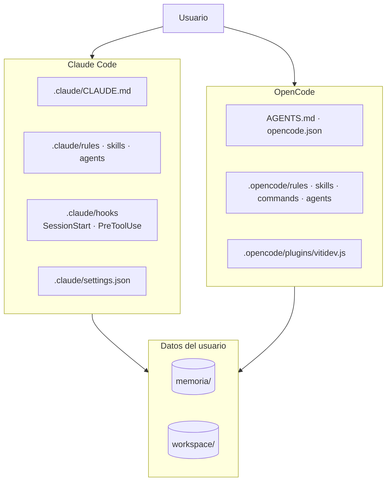

<p align="center">
  
</p>

# VITIDEV OS AI

Entorno de trabajo personal basado en archivos para usar un agente de IA como asistente que conoce
al usuario, recuerda lo importante entre sesiones y organiza su estudio, sus investigaciones y sus
proyectos. Funciona con **Claude Code** y con **OpenCode**, cada uno con su propia configuración.

## Descripción

VITIDEV OS AI no es una aplicación ni un modelo: es una carpeta con instrucciones, reglas, skills,
agentes, comandos y hooks en Markdown, JSON y JavaScript. Al abrirla con Claude Code u OpenCode, la
herramienta carga el perfil y los objetivos del usuario, un resumen del estado de sus proyectos y
las reglas de seguridad del proyecto.

| Pieza | Función |
|---|---|
| Memoria (`memoria/`) | Perfil, preferencias, objetivos, proyectos, aprendizajes y sesiones en Markdown |
| Workspace (`workspace/`) | Proyectos, universidad, investigaciones, entregables, inbox y archivo |
| Skills | Procedimientos: aprender, investigar, organizar, crear-proyecto, gestionar-memoria |
| Comandos | `/conocerme`, `/estudiar`, `/investigar`, `/guardar`, `/revisar-proyectos`, `/cerrar-sesion` |
| Agentes | `tutor`, `investigador`, `project-manager` (subagentes de solo lectura) |
| Protección | Bloqueo de secretos y de comandos destructivos; confirmación antes de cambiar la memoria |

## Objetivo

Que el contexto del usuario no se pierda al cerrar una conversación ni dependa de un proveedor:
la memoria es texto plano en el disco del usuario, legible y editable, y el modelo se elige en la
herramienta. Sirve también como material para talleres sobre agentes de IA
([guía de taller](docs/guia-taller.md)).

## Independencia entre Claude Code y OpenCode

Las dos herramientas tienen implementaciones **separadas**:

- Claude Code usa solo `.claude/`.
- OpenCode usa solo `AGENTS.md`, `opencode.json` y `.opencode/`.

Ninguna importa, enlaza ni genera archivos de la otra. Algunas skills tienen el mismo nombre en
ambas, pero son archivos distintos: editar `.claude/skills/aprender/SKILL.md` no cambia
`.opencode/skills/aprender/SKILL.md`. Que el formato `SKILL.md` sea compatible no significa que se
compartan.

Lo único común son los **datos del usuario** (`memoria/` y `workspace/`): lo que guardas con una
herramienta lo consultas con la otra.

OpenCode descubre por defecto las skills de `.claude/skills/` y `~/.claude/skills/`. El proyecto lo
neutraliza con skills propias de mayor prioridad y una allowlist en `permission.skill`
(`"*": "deny"`). Detalle en [docs/OPENCODE.md](docs/OPENCODE.md#aislamiento-respecto-a-claude-code).

## Arquitectura



| Función | Claude Code | OpenCode |
|---|---|---|
| Instrucciones | `.claude/CLAUDE.md` | `AGENTS.md` |
| Memoria inicial | Imports `@../memoria/...` | `instructions` de `opencode.json` |
| Reglas | `.claude/rules/` | `.opencode/rules/` (en `instructions`) |
| Skills | `.claude/skills/` (10, incluidas las 5 skills-comando) | `.opencode/skills/` (5) |
| Comandos | Skills con `disable-model-invocation: true` | `.opencode/commands/` (6) |
| Agentes | `.claude/agents/` (`tools`) | `.opencode/agents/` (`mode: subagent`, `permission`) |
| Permisos | `.claude/settings.json` | `opencode.json` |
| Protección | Hook `PreToolUse` + `.claude/hooks/lib/reglas.mjs` | Plugin `tool.execute.before` + `.opencode/lib/reglas.mjs` |
| Estado al iniciar | Hook `SessionStart` | Plugin `experimental.chat.system.transform` |

Explicación de cada carpeta y qué se puede modificar: [docs/ARCHITECTURE.md](docs/ARCHITECTURE.md).

## Estructura de directorios

```text
VITIDEV-OS-AI/
├── .claude/                 Ecosistema Claude Code
│   ├── CLAUDE.md            Instrucciones e imports de memoria
│   ├── settings.json        Permisos y registro de hooks
│   ├── rules/               seguridad, estilo, memoria, workspace
│   ├── skills/              10 skills (5 de capacidad, 5 comandos)
│   ├── agents/              tutor, investigador, project-manager
│   └── hooks/               session-start.mjs, proteger.mjs y lib/
├── .opencode/               Ecosistema OpenCode
│   ├── rules/               seguridad, estilo, memoria, workspace
│   ├── skills/              5 skills de capacidad
│   ├── commands/            6 comandos
│   ├── agents/              tutor, investigador, project-manager
│   ├── plugins/vitidev.js   Protección y resumen de estado
│   └── lib/                 reglas.mjs, estado.mjs, adaptador.mjs
├── AGENTS.md                Instrucciones de OpenCode
├── opencode.json            Configuración de OpenCode (sin modelo ni claves)
├── memoria/                 Memoria persistente (compartida)
├── workspace/               Espacio de trabajo (compartido)
├── scripts/                 validar.mjs, probar-opencode.mjs
├── tests/                   Pruebas con node:test
├── docs/                    Documentación
├── .github/                 Plantillas de issues y Pull Request
├── package.json             Scripts test, validar, probar:opencode
└── BANNER.jpg, LICENSE, CHANGELOG.md, CONTRIBUTING.md, SECURITY.md, CODE_OF_CONDUCT.md
```

## Requisitos previos

| Requisito | Versión | Notas |
|---|---|---|
| [Node.js](https://nodejs.org) | 20 o superior | Hooks, plugin, validador y pruebas. Sin dependencias |
| [Claude Code](https://code.claude.com/docs/en/setup) | 2.1.x | Cuenta de Claude o clave de la API de Anthropic |
| [OpenCode](https://opencode.ai/docs/) | 1.x (V1) | Cualquier proveedor compatible. V2 no ejecuta el plugin |
| [Git](https://git-scm.com) | Reciente | Para clonar y actualizar |

Basta con una de las dos herramientas. Verificado en Windows 11; Linux y macOS sin verificar.

```bash
git clone https://github.com/VITIDEV06/VITIDEV-OS-AI.git
cd VITIDEV-OS-AI
npm test
```

## Claude Code: instalación y configuración

```bash
npm install -g @anthropic-ai/claude-code
claude
```

1. Acepta confiar en la carpeta: sin eso no se ejecutan los hooks.
2. Escribe `/` para ver los comandos y `/agents` para ver los agentes.
3. Ejecuta `/conocerme` para completar tu perfil.

No hay nada que configurar en el proyecto. El modelo se cambia con `/model`. Los ajustes
personales van en `.claude/settings.local.json`, excluido de git.
Referencia: [docs/CLAUDE-CODE.md](docs/CLAUDE-CODE.md).

## OpenCode: instalación y configuración

```bash
npm install -g opencode-ai
opencode auth login
npm run probar:opencode
opencode
```

1. `opencode auth login` guarda las credenciales del proveedor fuera del proyecto.
2. `npm run probar:opencode` comprueba la configuración sin usar ningún modelo.
3. Escribe `/` para ver los comandos y `@` para los agentes. Ejecuta `/conocerme`.

El modelo se elige con `/models` o `opencode -m proveedor/modelo`; un modelo por defecto va en tu
configuración global (`~/.config/opencode/opencode.json`), no en el proyecto. Para que OpenCode ni
siquiera descubra skills de Claude Code, inícialo con `OPENCODE_DISABLE_CLAUDE_CODE_SKILLS=1`.
Referencia: [docs/OPENCODE.md](docs/OPENCODE.md).

## Cómo crear una skill

En las dos herramientas el archivo es `SKILL.md` con `name` (igual que la carpeta) y `description`
(cuándo usarla). Cuerpo recomendado: Objetivo, Cuándo activarse, Procedimiento, Reglas y Resultado
esperado.

```markdown
---
name: resumir-pdf
description: Resume un PDF en puntos clave. Úsala cuando el usuario pida "resume este PDF".
---

# Skill: resumir PDF
```

| Paso | Claude Code | OpenCode |
|---|---|---|
| Ubicación | `.claude/skills/<nombre>/SKILL.md` | `.opencode/skills/<nombre>/SKILL.md` |
| Registro | Ninguno | Añadir `"<nombre>": "allow"` en `permission.skill` de `opencode.json` |
| Rutas internas | `.claude/skills/<nombre>/...` | `.opencode/skills/<nombre>/...` |

Si quieres la skill en las dos herramientas, crea los dos archivos. No los enlaces.

## Cómo crear comandos y agentes

| | Claude Code | OpenCode |
|---|---|---|
| Comando | Skill en `.claude/skills/<nombre>/` con `disable-model-invocation: true` y `$ARGUMENTS` | `.opencode/commands/<nombre>.md` con `description` y `$ARGUMENTS` |
| Agente | `.claude/agents/<nombre>.md` con `name`, `description`, `tools`, `model: inherit` | `.opencode/agents/<nombre>.md` con `description`, `mode: subagent`, `permission` |
| Invocar un agente | Herramienta `Agent` o `/agents` | Herramienta `task` o `@nombre` |

Ejemplos completos y campos admitidos: [docs/CLAUDE-CODE.md](docs/CLAUDE-CODE.md) y
[docs/OPENCODE.md](docs/OPENCODE.md).

## Cómo mantener la independencia

- Un cambio para Claude Code va en `.claude/`; uno para OpenCode, en `AGENTS.md`, `opencode.json` o
  `.opencode/`. Si debe estar en las dos, se hace dos veces.
- No uses imports, symlinks ni scripts de generación entre ecosistemas.
- No crees un `CLAUDE.md` en la raíz ni añadas rutas de `.claude/` a `opencode.json`.
- La lógica de protección está duplicada a propósito (`.claude/hooks/lib/reglas.mjs` y
  `.opencode/lib/reglas.mjs`); `npm test` comprueba que ambas copias aplican la misma política.
- `npm run validar` falla si un archivo de un ecosistema referencia al otro.

## Ejemplos de uso

```text
/conocerme
/estudiar recursividad 20
/investigar ¿qué es el repaso espaciado?
/guardar prefiero ejemplos antes que teoría
/revisar-proyectos
/cerrar-sesion
```

También en lenguaje natural: "explícame las derivadas parciales", "crea un proyecto para el taller
de IA", "organiza mi inbox", "¿qué sabes de mí?".

OpenCode permite lanzar un comando sin interfaz:

```bash
opencode run --command guardar "prefiero respuestas breves"
```

## Seguridad y buenas prácticas

| Capa | Claude Code | OpenCode |
|---|---|---|
| 1. Instrucciones | `.claude/rules/seguridad.md` | `.opencode/rules/seguridad.md` |
| 2. Permisos | `allow` / `ask` / `deny` en `.claude/settings.json` | `permission` en `opencode.json` |
| 3. Bloqueo en tiempo real | Hook `PreToolUse` | Plugin `tool.execute.before` |

- Se bloquea leer o editar `.env`, `*.pem`, `*.key`, claves SSH, `secrets/` y `credenciales/`.
- Se bloquean `rm -r`, `Remove-Item -Recurse`, `rd /s`, `git push --force`, `git reset --hard`,
  `git clean -f` y `sudo`.
- Cambiar un dato existente de `memoria/` requiere aprobación; lo descartado se mueve a
  `workspace/_archivo/`.
- El proyecto no contiene modelo, proveedor ni credenciales. No los añadas.
- No uses modos que omiten permisos (`--dangerously-skip-permissions`, `--auto`).
- La memoria se envía al proveedor del modelo como contexto: no guardes contraseñas ni datos
  sensibles. `.gitignore` excluye lo que creas en `memoria/aprendizajes/`, `memoria/sesiones/` y
  `workspace/`; las plantillas de memoria siguen versionadas, así que revisa `git status` antes de
  publicar.
- La protección se basa en patrones: no es un sandbox.

Más detalle: [SECURITY.md](SECURITY.md) y [docs/PRIVACIDAD-Y-MEMORIA.md](docs/PRIVACIDAD-Y-MEMORIA.md).

Verificación:

```bash
npm run validar
npm test
npm run probar:opencode
```

Estado de verificación y limitaciones conocidas: [docs/limitaciones.md](docs/limitaciones.md).
Otras guías: [primeros pasos](docs/PRIMEROS-PASOS.md), [FAQ](docs/FAQ.md),
[glosario](docs/GLOSARIO.md), [decisiones técnicas](docs/decisiones.md).

## Referencias oficiales

| Tema | Claude Code | OpenCode |
|---|---|---|
| General | [code.claude.com/docs](https://code.claude.com/docs/en/overview) | [opencode.ai/docs](https://opencode.ai/docs/) |
| Instrucciones | [Memory (CLAUDE.md)](https://code.claude.com/docs/en/memory) | [Rules (AGENTS.md)](https://opencode.ai/docs/rules/) |
| Skills | [Skills](https://code.claude.com/docs/en/skills) | [Skills](https://opencode.ai/docs/skills/) |
| Agentes | [Subagents](https://code.claude.com/docs/en/sub-agents) | [Agents](https://opencode.ai/docs/agents/) |
| Comandos | [Skills](https://code.claude.com/docs/en/skills) | [Commands](https://opencode.ai/docs/commands/) |
| Automatización | [Hooks](https://code.claude.com/docs/en/hooks) | [Plugins](https://opencode.ai/docs/plugins/) |
| Configuración | [Settings](https://code.claude.com/docs/en/settings) | [Config](https://opencode.ai/docs/config/) · [Permissions](https://opencode.ai/docs/permissions/) |

## Licencia y contribuciones

[MIT](LICENSE). Copyright (c) 2026 Victor Montes.

Para contribuir, lee [CONTRIBUTING.md](CONTRIBUTING.md) y el
[código de conducta](CODE_OF_CONDUCT.md). Las vulnerabilidades se informan en privado según
[SECURITY.md](SECURITY.md). Historial de cambios: [CHANGELOG.md](CHANGELOG.md).
