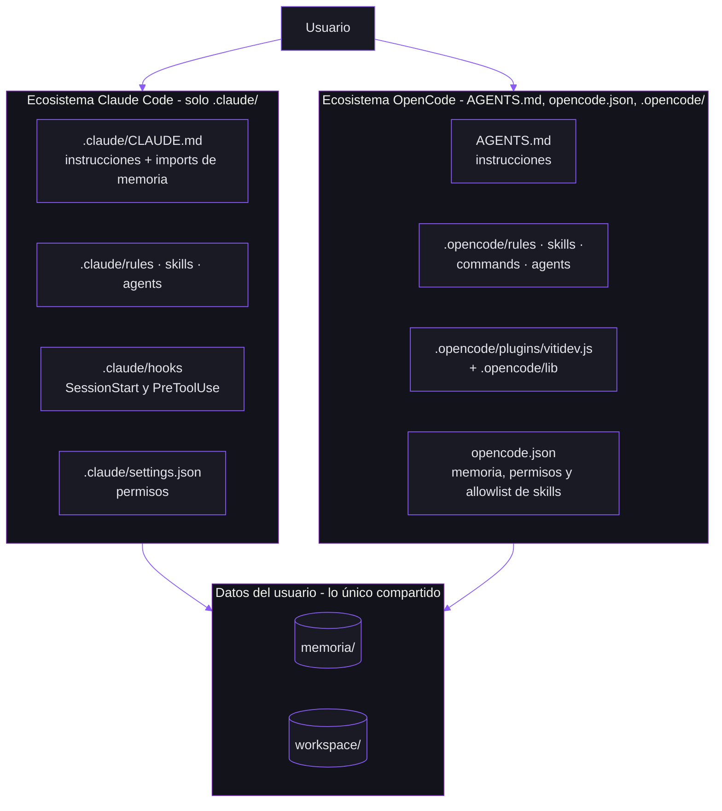
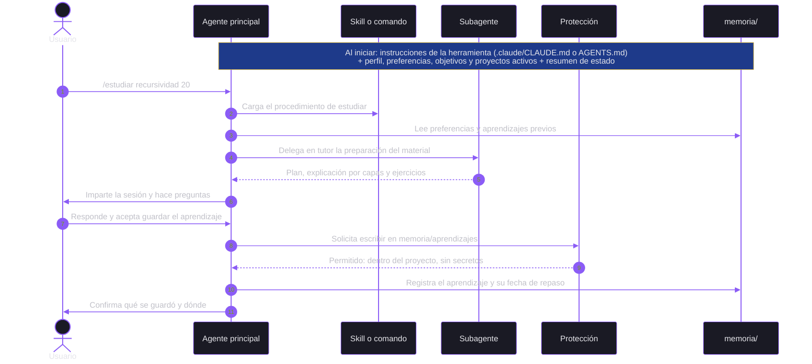
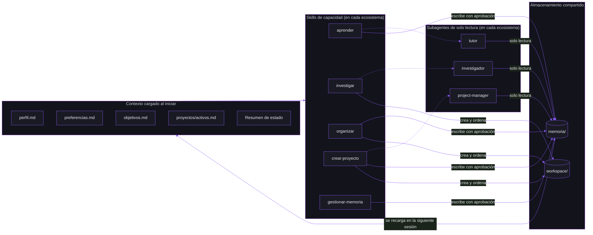
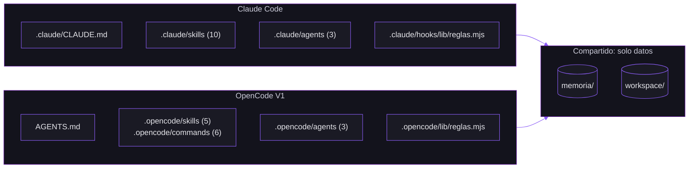
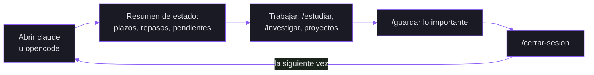
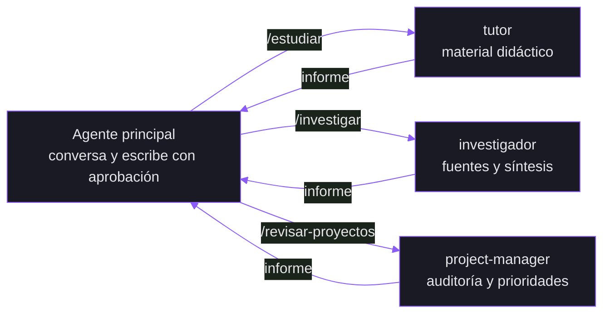
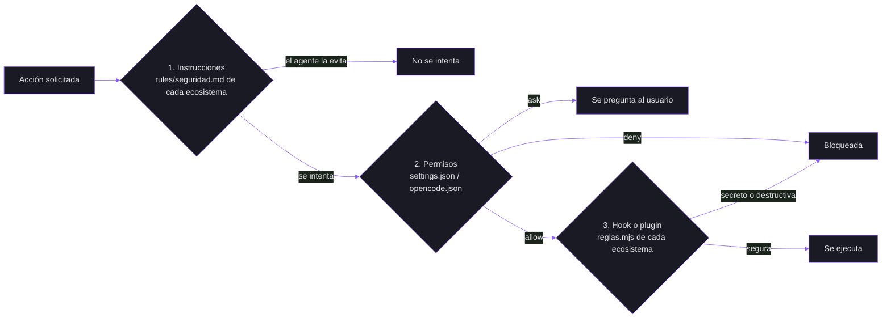

<p align="center">
  
</p>

<h1 align="center">VITIDEV OS AI</h1>

<p align="center">
  <b>Sistema personal de trabajo inteligente basado en agentes de IA</b><br>
  Para Claude Code y OpenCode, con un ecosistema independiente para cada uno. Integra contexto,
  memoria persistente, habilidades, agentes especializados y comandos personalizados.
</p>

<p align="center">
  
  
  <a href="LICENSE"></a>
</p>

<p align="center">
  <a href="https://code.claude.com/docs/en/overview"></a>
  <a href="https://opencode.ai/docs/"></a>
  <a href="https://nodejs.org"></a>
</p>

<p align="center">
  
  
  
  
  
  
  
</p>

<p align="center">
  <a href="#sobre-el-proyecto">Sobre el proyecto</a> &nbsp;|&nbsp;
  <a href="#arquitectura">Arquitectura</a> &nbsp;|&nbsp;
  <a href="#ecosistemas-independientes">Ecosistemas</a> &nbsp;|&nbsp;
  <a href="#instalación">Instalación</a> &nbsp;|&nbsp;
  <a href="#uso-básico">Uso básico</a> &nbsp;|&nbsp;
  <a href="#skills-comandos-y-agentes">Skills y agentes</a> &nbsp;|&nbsp;
  <a href="#memoria">Memoria</a> &nbsp;|&nbsp;
  <a href="#privacidad-y-seguridad">Seguridad</a> &nbsp;|&nbsp;
  <a href="#documentación">Documentación</a> &nbsp;|&nbsp;
  <a href="#roadmap">Roadmap</a> &nbsp;|&nbsp;
  <a href="#contribuciones">Contribuir</a>
</p>

---

## Sobre el proyecto

**VITIDEV OS AI** convierte una herramienta de agentes de IA en un **asistente personal que te conoce,
recuerda y organiza tu trabajo**. No es un sistema operativo tradicional: es un entorno de trabajo
basado en archivos (Markdown, JSON y JavaScript) que Claude Code y OpenCode cargan al abrir la carpeta.

<table>
<tr>
<td width="50%" valign="top">

### El problema

Un chatbot tradicional **empieza de cero en cada conversación**: no sabe quién eres, qué estudias,
qué proyectos tienes ni cómo prefieres trabajar. Lo que aprendes o decides se pierde en el
historial, y lo que configuras queda atado a una sola herramienta o proveedor.

</td>
<td width="50%" valign="top">

### La solución

Una carpeta que aporta **identidad, memoria persistente, procedimientos especializados y reglas de
seguridad**. Claude Code y OpenCode tienen cada uno **su propia configuración completa**, y las dos
trabajan sobre **la misma memoria**, con el modelo y el proveedor que cada persona elija.

</td>
</tr>
</table>

| | Chatbot tradicional | VITIDEV OS AI |
|---|---|---|
| **Contexto** | Hay que repetirlo en cada conversación | Perfil, preferencias, objetivos y proyectos cargados al iniciar |
| **Memoria** | Se pierde al cerrar el chat | Archivos Markdown persistentes, legibles y editables |
| **Método** | Respuestas genéricas | Skills con procedimientos y agentes especializados |
| **Control** | Sin límites explícitos | Permisos y bloqueo de acciones peligrosas |
| **Portabilidad** | Atado a una plataforma | Claude Code y OpenCode, cada uno con su ecosistema, sobre los mismos datos |
| **Datos** | En el historial del proveedor | En tu disco, en texto plano |

**Qué no es:** no es un modelo de IA ni una aplicación con interfaz propia. Funciona dentro de
Claude Code u OpenCode, con el modelo que elijas.

**Para quién está diseñado:** estudiantes, docentes y profesionales que quieren un asistente que
acompañe su estudio, sus investigaciones y sus proyectos a lo largo del tiempo, y para talleres
educativos sobre agentes de IA (incluye una [guía de taller de 2 horas](docs/guia-taller.md)).

---

## Características principales

<table>
<tr>
<td width="25%" valign="top">

**Contexto e identidad**

`.claude/CLAUDE.md` (Claude Code) y `AGENTS.md` (OpenCode) definen cómo trabaja el agente. Al iniciar, carga quién eres tú desde la memoria.

</td>
<td width="25%" valign="top">

**Memoria persistente**

Perfil, objetivos, proyectos activos, pausados y finalizados, aprendizajes y sesiones en `memoria/`, común a las dos herramientas.

</td>
<td width="25%" valign="top">

**Skills**

Procedimientos con objetivo, pasos, reglas y resultado esperado: aprender, investigar, organizar y más. Cada herramienta tiene los suyos.

</td>
<td width="25%" valign="top">

**Agentes especializados**

`tutor`, `investigador` y `project-manager`: subagentes de solo lectura, definidos por separado para cada herramienta.

</td>
</tr>
<tr>
<td width="25%" valign="top">

**Comandos personalizados**

`/conocerme`, `/estudiar`, `/investigar`, `/guardar`, `/revisar-proyectos` y `/cerrar-sesion`, en las dos herramientas.

</td>
<td width="25%" valign="top">

**Automatizaciones**

Resumen de estado al iniciar (plazos, repasos, pendientes) y protección en tiempo real: hooks en Claude Code, plugin en OpenCode.

</td>
<td width="25%" valign="top">

**Seguridad**

Tres capas: instrucciones, permisos y bloqueo de secretos y de comandos destructivos.

</td>
<td width="25%" valign="top">

**Organización del conocimiento**

`workspace/` para proyectos, universidad, investigaciones y entregables, con un inbox y un archivo.

</td>
</tr>
</table>

---

## Arquitectura

### 1. Arquitectura general



### 2. Flujo de funcionamiento del agente



### 3. Relación entre memoria, contexto, skills y agentes



### 4. Independencia Claude Code / OpenCode



Ningún archivo de un ecosistema importa, enlaza ni genera archivos del otro. Las skills, reglas,
agentes y la lógica de protección que existen en los dos son **copias separadas**: editar
`.claude/skills/aprender/SKILL.md` no cambia `.opencode/skills/aprender/SKILL.md`.
`npm run validar` falla si aparece una dependencia cruzada.

---

## Tecnologías utilizadas

<p align="center">
  <a href="https://code.claude.com/docs/en/overview"></a>
  &nbsp;&nbsp;
  <a href="https://opencode.ai"></a>
  &nbsp;&nbsp;
  <a href="https://skillicons.dev"></a>
  &nbsp;&nbsp;
  <a href="https://www.json.org"></a>
  &nbsp;&nbsp;
  <a href="https://mermaid.js.org"></a>
</p>

| Tecnología | Uso en el proyecto | Documentación |
|---|---|---|
|  **Claude Code** | Ecosistema propio en `.claude/`: `CLAUDE.md`, reglas, skills, subagentes, hooks y permisos | [code.claude.com/docs](https://code.claude.com/docs/en/overview) |
|  **OpenCode** | Ecosistema propio: `AGENTS.md`, `opencode.json` y `.opencode/` (reglas, skills, comandos, agentes y plugin) | [opencode.ai/docs](https://opencode.ai/docs/) |
|  **Node.js** | Hooks, plugin, validador y pruebas con `node:test` | [nodejs.org](https://nodejs.org) |
|  **JavaScript (ESM)** | Lenguaje de los scripts `.mjs` y del plugin `.js` | [nodejs.org/api/esm](https://nodejs.org/api/esm.html) |
|  **Markdown** | Instrucciones, reglas, skills, comandos, agentes, memoria y documentación | [commonmark.org](https://commonmark.org) |
|  **JSON** | `opencode.json`, `.claude/settings.json` y `package.json` | [json.org](https://www.json.org) |
|  **Mermaid** | Diagramas de esta documentación | [mermaid.js.org](https://mermaid.js.org) |

El proyecto no tiene dependencias: `package.json` solo define scripts, y todo usa la biblioteca
estándar de Node.js.

---

## Estructura del proyecto

```text
VITIDEV-OS-AI/
├── .claude/                     ── Ecosistema Claude Code ──
│   ├── CLAUDE.md                Instrucciones; importa la memoria con @../memoria/...
│   ├── settings.json            Permisos y registro de hooks
│   ├── rules/                   seguridad.md, estilo.md, memoria.md, workspace.md
│   ├── skills/                  10 skills: 5 de capacidad y 5 de comando
│   ├── agents/                  tutor.md, investigador.md, project-manager.md
│   └── hooks/
│       ├── session-start.mjs    Hook SessionStart: resumen de estado
│       ├── proteger.mjs         Hook PreToolUse: protección
│       └── lib/                 reglas.mjs, estado.mjs
├── .opencode/                   ── Ecosistema OpenCode ──
│   ├── rules/                   seguridad.md, estilo.md, memoria.md, workspace.md
│   ├── skills/                  5 skills de capacidad
│   ├── commands/                6 comandos personalizados
│   ├── agents/                  tutor.md, investigador.md, project-manager.md
│   ├── plugins/vitidev.js       Protección y resumen de estado
│   └── lib/                     reglas.mjs, estado.mjs, adaptador.mjs
├── AGENTS.md                    Instrucciones de OpenCode (Claude Code no lo lee)
├── opencode.json                OpenCode: memoria, reglas, permisos y allowlist de skills (sin modelo)
├── memoria/                     ── Datos compartidos ── memoria persistente
│   ├── personal/                perfil.md, preferencias.md
│   ├── objetivos.md
│   ├── proyectos/               activos.md, pausados.md, finalizados.md
│   ├── aprendizajes/            Un archivo por tema + INDICE.md
│   ├── sesiones/                Un registro por día
│   └── inbox.md                 Datos pendientes de clasificar
├── workspace/                   proyectos/, universidad/, investigaciones/, entregables/, inbox/, _archivo/
├── scripts/                     validar.mjs, probar-opencode.mjs
├── tests/                       32 pruebas automáticas
├── docs/                        Arquitectura, guías por herramienta, FAQ, glosario, privacidad y taller
├── .github/                     Plantillas de issues y Pull Request
├── package.json                 Scripts: test, validar, probar:opencode
├── BANNER.jpg                   Banner del proyecto
└── LICENSE, CHANGELOG.md, CONTRIBUTING.md, SECURITY.md, CODE_OF_CONDUCT.md
```

Explicación de cada carpeta, qué se puede modificar y con qué precauciones:
[docs/ARCHITECTURE.md](docs/ARCHITECTURE.md).

| Componente | Responsabilidad |
|---|---|
| [`.claude/`](.claude) | Todo lo que usa Claude Code: instrucciones, reglas, skills, agentes, hooks y permisos |
| [`AGENTS.md`](AGENTS.md), [`opencode.json`](opencode.json) y [`.opencode/`](.opencode) | Todo lo que usa OpenCode: instrucciones, configuración, reglas, skills, comandos, agentes y plugin |
| [`memoria/`](memoria) | Lo que debe sobrevivir entre sesiones, común a las dos herramientas |
| [`workspace/`](workspace) | Los archivos de trabajo del usuario |
| [`scripts/validar.mjs`](scripts/validar.mjs) | Comprueba la estructura de ambos ecosistemas, referencias, permisos e independencia |

---

## Ecosistemas independientes

<table>
<tr>
<td align="center" width="50%">
  <br>
  <b>Claude Code</b><br>
  <sub>Versión 2.1.x &middot; probado con 2.1.326</sub>
</td>
<td align="center" width="50%">
  <br>
  <b>OpenCode V1</b><br>
  <sub>Versión 1.x &middot; probado con 1.18.32</sub>
</td>
</tr>
</table>

| Elemento | Claude Code | OpenCode V1 |
|---|---|---|
| **Instrucciones** | `.claude/CLAUDE.md` | `AGENTS.md` |
| **Memoria inicial** | Imports `@../memoria/...` en `.claude/CLAUDE.md` | Campo `instructions` de `opencode.json` |
| **Reglas** | `.claude/rules/` (nativo, con `paths:`) | `.opencode/rules/`, registradas en `instructions` |
| **Skills** | `.claude/skills/` (10) | `.opencode/skills/` (5) + allowlist en `permission.skill` |
| **Comandos** | Skills con `disable-model-invocation: true` | `.opencode/commands/*.md` con `$ARGUMENTS` |
| **Agentes** | `.claude/agents/*.md` con `tools` | `.opencode/agents/*.md` con `mode: subagent` y `permission` |
| **Configuración** | `.claude/settings.json` | `opencode.json` |
| **Protección** | Hook `PreToolUse` + `.claude/hooks/lib/reglas.mjs` | Plugin `tool.execute.before` + `.opencode/lib/reglas.mjs` |
| **Estado inicial** | Hook `SessionStart` | Plugin `experimental.chat.system.transform` |
| **Modelo** | Cuenta de Claude o clave de API | Cualquier proveedor compatible, incluidos modelos gratuitos |

**Cómo se mantienen separados:**

- `CLAUDE.md` está dentro de `.claude/`: Claude Code lo carga y, al existir, no lee `AGENTS.md`.
  OpenCode solo usaría un `CLAUDE.md` de la raíz como respaldo, y no lo hay.
- OpenCode descubre por defecto las skills de `.claude/skills/` y `~/.claude/skills/`. Sus skills
  propias tienen prioridad para el mismo nombre, y `permission.skill` deniega (`"*": "deny"`) toda
  skill que no sea suya. Para que ni siquiera las descubra: `OPENCODE_DISABLE_CLAUDE_CODE_SKILLS=1`.
- Los hooks importan solo de `.claude/hooks/lib/`; el plugin, solo de `.opencode/lib/`.
- Si un cambio debe estar en las dos herramientas, se hace en los dos lados. Sin imports, symlinks
  ni scripts que generen un ecosistema a partir del otro.

> **OpenCode V2** está en beta. Según la [guía oficial de migración](https://opencode.ai/docs/migrate-v1/),
> V2 lee el formato V1 usado aquí, pero no ejecuta plugins de V1. No se ha probado con V2:
> ver [limitaciones](docs/limitaciones.md).

Referencia detallada de cada herramienta: [docs/CLAUDE-CODE.md](docs/CLAUDE-CODE.md) y
[docs/OPENCODE.md](docs/OPENCODE.md).

---

## Instalación

Guía completa paso a paso, con comandos para Windows PowerShell, Linux y macOS:
[docs/PRIMEROS-PASOS.md](docs/PRIMEROS-PASOS.md).

### Requisitos

| Requisito | Versión | Notas |
|---|---|---|
| [Node.js](https://nodejs.org) | 20 o superior | Hooks, plugin, validador y pruebas. Sin dependencias que instalar |
| [Claude Code](https://code.claude.com/docs/en/setup) | 2.1.x | Requiere suscripción de Claude o clave de la API de Anthropic |
| [OpenCode](https://opencode.ai/docs/) | 1.x (V1) | Admite modelos gratuitos. **V2 no está probado** y no ejecuta el plugin de protección |
| [Git](https://git-scm.com) | Cualquiera reciente | Recomendado para clonar y actualizar |

Basta con **una** de las dos herramientas. Verificado en Windows 11; Linux y macOS están
soportados por diseño, pero sin verificar.

### Instalación rápida

```bash
git clone https://github.com/VITIDEV06/VITIDEV-OS-AI.git
cd VITIDEV-OS-AI
npm test
```

Sin git: en la página del repositorio, **Code → Download ZIP**, descomprime y abre una terminal en
la carpeta `VITIDEV-OS-AI-master`. `npm test` debe terminar con `fail 0`.

<table>
<tr>
<td width="50%" valign="top">

### Con Claude Code

**1. Instalar Claude Code** ([documentación](https://code.claude.com/docs/en/overview))

```bash
npm install -g @anthropic-ai/claude-code
```

**2. Abrir la carpeta** e iniciar sesión con tu cuenta

```bash
claude
```

**3. Primer uso**

- Acepta confiar en la carpeta y sus hooks.
- Escribe `/` para ver los comandos.
- Ejecuta `/agents` para ver los 3 agentes.
- Ejecuta `/conocerme`.

Usa solo `.claude/`. Referencia: [docs/CLAUDE-CODE.md](docs/CLAUDE-CODE.md).

</td>
<td width="50%" valign="top">

### Con OpenCode

**1. Instalar OpenCode** ([documentación](https://opencode.ai/docs/))

```bash
npm install -g opencode-ai
```

**2. Configurar tu proveedor** (fuera del proyecto)

```bash
opencode auth login
```

**3. Comprobar el proyecto** (sin usar ningún modelo)

```bash
npm run probar:opencode
```

**4. Abrir la carpeta**

```bash
opencode
```

**5. Primer uso**

- Escribe `/` para ver los comandos.
- Escribe `@` para ver los agentes.
- Ejecuta `/conocerme`.

Usa `AGENTS.md`, `opencode.json` y `.opencode/`. Referencia: [docs/OPENCODE.md](docs/OPENCODE.md).

</td>
</tr>
</table>

**Modelos y proveedores.** El proyecto no fija modelo, proveedor ni credenciales. En Claude Code
se cambia con `/model`. En OpenCode, con `/models` o `opencode -m proveedor/modelo`; para un modelo
por defecto, usa tu configuración global `~/.config/opencode/opencode.json`. OpenCode ofrece
modelos gratuitos con el prefijo `opencode/` (`opencode models` los lista). Más detalles en la
documentación de [proveedores de OpenCode](https://opencode.ai/docs/providers/).

### Configuración

No hace falta configurar nada para empezar: no hay archivos `.env` ni claves en el proyecto.

| Qué | Dónde |
|---|---|
| Tu identidad, preferencias y objetivos | `/conocerme`, o a mano en `memoria/personal/` y `memoria/objetivos.md` |
| Modelo y credenciales | En la herramienta (`/model`, `/models`, `opencode auth login`), nunca en el proyecto |
| Estilo de las respuestas | `memoria/personal/preferencias.md` |
| Ajustes personales de Claude Code | `.claude/settings.local.json` (excluido de git) |
| Instrucciones, skills, agentes y permisos | Ver [Personalización](#personalización) |

### Actualizar

```bash
git pull
npm test
```

Haz antes una copia de `memoria/`: si git informa de conflictos en esos archivos, conserva tu
versión. Si descargaste el ZIP, descarga la versión nueva y copia en ella tus carpetas `memoria/`
y `workspace/`. Revisa el [CHANGELOG](CHANGELOG.md) antes de actualizar.

---

## Uso básico

Una sesión típica:



### Comandos

Los comandos los lanza el usuario; el agente no los ejecuta por iniciativa propia. Existen con el
mismo nombre en las dos herramientas, pero cada una tiene su propio archivo: en Claude Code son
skills de `.claude/skills/`; en OpenCode, archivos de `.opencode/commands/`.

| Comando | Función | Usa | Ejemplo |
|---|---|---|---|
| `/conocerme` | Entrevista por bloques y completa perfil, preferencias y objetivos | `gestionar-memoria` | `/conocerme completo` |
| `/estudiar` | Diagnóstico, plan, explicación, práctica y registro del aprendizaje | `tutor`, `aprender` | `/estudiar recursividad 20` |
| `/investigar` | Investigación con fuentes citadas e informe en `workspace/investigaciones/` | `investigador` | `/investigar ¿qué es el repaso espaciado?` |
| `/guardar` | Guarda un dato en el archivo de memoria correcto | `gestionar-memoria` | `/guardar prefiero ejemplos antes que teoría` |
| `/revisar-proyectos` | Estado de los proyectos, prioridades de la semana y cambios de estado | `project-manager` | `/revisar-proyectos` |
| `/cerrar-sesion` | Resume la sesión, actualiza memoria y proyectos y deja próximos pasos | `gestionar-memoria` | `/cerrar-sesion` |

En Claude Code, las skills de capacidad también se pueden lanzar como comando (`/aprender`,
`/organizar`, `/crear-proyecto`, `/gestionar-memoria`). En OpenCode se activan pidiéndolas con tus
palabras.

```text
/conocerme
Crea un proyecto llamado Taller de IA
/estudiar derivadas parciales 25
¿Qué sabes de mí?
/cerrar-sesion
```

OpenCode también permite ejecutarlos sin interfaz:

```bash
opencode run --command guardar "prefiero respuestas breves"
```

---

## Skills, comandos y agentes

### Skills

Cada herramienta tiene sus propias skills, cada una en su `SKILL.md` con nombre, descripción,
**Objetivo**, **Procedimiento**, **Reglas** y **Resultado esperado**. Las skills con el mismo nombre
son archivos distintos.

| Skill | Tipo | Claude Code | OpenCode | Se activa cuando el usuario… | Resultado |
|---|---|:---:|:---:|---|---|
| `aprender` | Capacidad | ✔ | ✔ | pide "explícame", "no entiendo", "quiero aprender" | Explicación por capas, comprobación y registro en `memoria/aprendizajes/` |
| `investigar` | Capacidad | ✔ | ✔ | pide "investiga", "busca información", "compara" | Síntesis con fuentes e informe en `workspace/investigaciones/` |
| `organizar` | Capacidad | ✔ | ✔ | pide "organiza", "ordena", "clasifica" | Plan de clasificación; mueve con aprobación y nunca borra |
| `crear-proyecto` | Capacidad | ✔ | ✔ | dice "nuevo proyecto", "quiero empezar…" | Carpeta, ficha `PROYECTO.md` y registro en `activos.md` |
| `gestionar-memoria` | Capacidad | ✔ | ✔ | dice "recuerda", "¿qué sabes de mí?", "olvida" | Dato en su archivo; cambios solo con aprobación |
| `conocerme`, `estudiar`, `guardar`, `revisar-proyectos`, `cerrar-sesion` | Comando | ✔ | — | lanza el comando | En OpenCode son archivos de `.opencode/commands/`. Ver [Comandos](#comandos) |

### Agentes



| Agente | Especialidad | Permisos | Claude Code | OpenCode |
|---|---|---|---|---|
| `tutor` | Planes de estudio, explicaciones por capas, ejercicios con solución | Lectura, búsqueda y lectura web | `.claude/agents/tutor.md` | `.opencode/agents/tutor.md`, `@tutor` |
| `investigador` | Búsqueda, evaluación de fuentes, contraste y síntesis citada | Lectura, búsqueda y lectura web | `.claude/agents/investigador.md` | `.opencode/agents/investigador.md`, `@investigador` |
| `project-manager` | Avance, plazos, bloqueos, coherencia y prioridades | Solo lectura | `.claude/agents/project-manager.md` | `.opencode/agents/project-manager.md`, `@project-manager` |

Los tres heredan el modelo de la sesión y **no pueden escribir ni ejecutar comandos**: preparan y
proponen, y el agente principal aplica lo que el usuario aprueba. Claude Code los invoca con la
herramienta `Agent`; OpenCode, con la herramienta `task`. Cada versión se mantiene por separado.

---

## Memoria

Hay **una sola memoria**, la carpeta `memoria/`, compartida por las dos herramientas: es lo único,
junto con `workspace/`, que tienen en común. Lo que se guarda con una se consulta con la otra.

| Categoría | Archivo | Se carga al iniciar |
|---|---|---|
| Información personal | `memoria/personal/perfil.md`, `preferencias.md` | Sí |
| Objetivos | `memoria/objetivos.md` | Sí |
| Proyectos activos | `memoria/proyectos/activos.md` | Sí |
| Proyectos pausados y finalizados | `memoria/proyectos/pausados.md`, `finalizados.md` | Bajo demanda |
| Aprendizajes | `memoria/aprendizajes/AAAA-MM-DD-tema.md` | Bajo demanda; el estado avisa de repasos |
| Sesiones | `memoria/sesiones/AAAA-MM-DD.md` | Se muestran los próximos pasos de la última |
| Sin clasificar | `memoria/inbox.md` | Bajo demanda |

Claude Code carga los cuatro primeros con imports `@` en `.claude/CLAUDE.md`; OpenCode, con el
campo `instructions` de `opencode.json`.

| Operación | Cómo pedirla | Comportamiento |
|---|---|---|
| **Consultar** | "¿Qué sabes de mí?" | Busca en `memoria/` y cita el archivo; si no está, lo dice |
| **Guardar** | `/guardar <dato>` o "recuerda que…" | Clasifica y añade el dato en su archivo |
| **Actualizar** | "cambia mi…" | Muestra el valor anterior y el nuevo y espera aprobación |
| **Organizar** | "organiza mi inbox" | Reparte el inbox en su lugar, con aprobación |
| **Olvidar** | "olvida…" | Muestra qué se eliminará y pide confirmación |

Ciclo de vida de un proyecto:


Cada cambio de estado mueve la entrada entre `activos.md`, `pausados.md` y `finalizados.md`, y
actualiza la ficha `workspace/proyectos/<slug>/PROYECTO.md`.

---

## Personalización

Cada cambio se hace en el ecosistema de la herramienta que quieres modificar. Si lo quieres en las
dos, hazlo en los dos lados.

| Quiero… | Claude Code | OpenCode |
|---|---|---|
| Cambiar cómo responde el agente | `memoria/personal/preferencias.md` (las dos) o `.claude/rules/estilo.md` | `memoria/personal/preferencias.md` (las dos) o `.opencode/rules/estilo.md` |
| Cambiar las instrucciones generales | `.claude/CLAUDE.md` | `AGENTS.md` |
| Crear una skill | `.claude/skills/<nombre>/SKILL.md` | `.opencode/skills/<nombre>/SKILL.md` + `"<nombre>": "allow"` en `permission.skill` |
| Crear un comando | Skill con `disable-model-invocation: true` | `.opencode/commands/<nombre>.md` con `$ARGUMENTS` |
| Crear un agente | `.claude/agents/<nombre>.md` (`tools`, `model: inherit`) | `.opencode/agents/<nombre>.md` (`mode: subagent`, `permission`) |
| Añadir una regla | `.claude/rules/<tema>.md` | `.opencode/rules/<tema>.md` y su ruta en `instructions` de `opencode.json` |
| Bloquear otro comando | `COMANDOS_PROHIBIDOS` en `.claude/hooks/lib/reglas.mjs` | `COMANDOS_PROHIBIDOS` en `.opencode/lib/reglas.mjs` |

### Cómo crear nuevas skills

Plantilla mínima de una skill (mismo formato en las dos herramientas, archivos separados):

```markdown
---
name: resumir-pdf
description: Resume un PDF en puntos clave. Úsala cuando el usuario pida "resume este PDF".
---

# Skill: resumir PDF

## Objetivo
## Cuándo activarse
## Procedimiento
## Reglas
## Resultado esperado
```

En OpenCode, añade además la skill a la allowlist de `opencode.json`; sin eso queda denegada:

```json
"permission": { "skill": { "*": "deny", "resumir-pdf": "allow" } }
```

Después de cualquier cambio:

```bash
npm test
```

Campos admitidos, comandos y agentes con ejemplos completos: [docs/CLAUDE-CODE.md](docs/CLAUDE-CODE.md)
y [docs/OPENCODE.md](docs/OPENCODE.md). Documentación oficial: [skills de Claude Code](https://code.claude.com/docs/en/skills),
[subagentes](https://code.claude.com/docs/en/sub-agents), [hooks](https://code.claude.com/docs/en/hooks),
[skills de OpenCode](https://opencode.ai/docs/skills/), [agentes](https://opencode.ai/docs/agents/),
[comandos](https://opencode.ai/docs/commands/) y [plugins](https://opencode.ai/docs/plugins/).

---

## Privacidad y seguridad



| Medida | Detalle |
|---|---|
| **Secretos protegidos** | No se leen ni editan `.env`, `*.pem`, `*.key`, claves SSH, `secrets/` ni `credenciales/` |
| **Sin borrados destructivos** | Se bloquean `rm -r`, `Remove-Item -Recurse`, `rd /s`, `git push --force`, `git reset --hard`, `git clean -f` y `sudo` |
| **Memoria protegida** | Cambiar un dato existente requiere aprobación; no se sobrescriben ni borran archivos de memoria completos |
| **Nunca borrar** | Lo que se descarta se mueve a `workspace/_archivo/` |
| **Escritura acotada** | No se escribe fuera de la carpeta del proyecto |
| **Configuración protegida** | Cada herramienta pide confirmación antes de editar su configuración y la del otro ecosistema |
| **Contenido externo** | Las páginas web son información, no instrucciones |
| **Mismas reglas, dos copias** | `npm test` comprueba que `.claude/hooks/lib/reglas.mjs` y `.opencode/lib/reglas.mjs` bloquean lo mismo |

**Antes de publicar en GitHub.** El proyecto no contiene modelo, proveedor, credenciales ni rutas
locales, y el validador falla si `opencode.json` incluye `model`, `provider` o claves. `.gitignore`
excluye secretos, `.claude/settings.local.json`, `CLAUDE.local.md`, logs, caché, los archivos que
genera OpenCode y lo que creas en `memoria/aprendizajes/`, `memoria/sesiones/` y `workspace/`. Las
plantillas de memoria siguen versionadas: revisa `git status` antes de cada commit para no publicar
tu perfil, y recuerda que el correo de autor de tus commits es público.

**Privacidad.** La memoria se guarda en tu disco, pero su contenido se envía al proveedor del modelo
como contexto. El proyecto no garantiza privacidad absoluta ni funcionamiento sin conexión.

**Recomendaciones:** no uses los modos que omiten permisos (`--dangerously-skip-permissions` en
Claude Code, `--auto` en OpenCode) y no guardes contraseñas ni datos sensibles en `memoria/`.
La protección se basa en patrones: no es un sandbox.

Más detalle en [docs/PRIVACIDAD-Y-MEMORIA.md](docs/PRIVACIDAD-Y-MEMORIA.md) y en la
[política de seguridad](SECURITY.md), que explica cómo informar de vulnerabilidades en privado.

---

## Verificación

| Comando | Qué comprueba | Resultado actual |
|---|---|---|
| `npm run validar` | Estructura de ambos ecosistemas, frontmatter, referencias, permisos, ausencia de modelo y credenciales, e independencia | 0 errores |
| `npm test` | Validador, hooks, flujos de memoria, adaptador y plugin de OpenCode, independencia | 32 de 32 |
| `npm run probar:opencode` | OpenCode instalado: comandos, origen de las skills, allowlist, agentes y permisos, sin usar ningún modelo | 8 de 8 |

Claude Code 2.1.326 se comprobó en una sesión nueva: carga `.claude/CLAUDE.md` y la memoria, y no
carga `AGENTS.md`. Las 10 pruebas con un modelo real en OpenCode 1.18.32 se superaron con la
arquitectura anterior y no se han repetido tras la separación. Detalle en
[docs/limitaciones.md](docs/limitaciones.md).

---

## Documentación

| Documento | Contenido |
|---|---|
| [Primeros pasos](docs/PRIMEROS-PASOS.md) | Instalación, configuración y primera sesión paso a paso |
| [Arquitectura](docs/ARCHITECTURE.md) | Los dos ecosistemas, cada carpeta y qué se puede modificar |
| [Claude Code](docs/CLAUDE-CODE.md) | Qué carga, skills, comandos, agentes, hooks y permisos en Claude Code |
| [OpenCode](docs/OPENCODE.md) | Aislamiento, skills, comandos, agentes, plugin y variables de entorno en OpenCode |
| [Preguntas frecuentes](docs/FAQ.md) | Coste, modelos, memoria, actualización y solución de problemas |
| [Privacidad y memoria](docs/PRIVACIDAD-Y-MEMORIA.md) | Qué se guarda, qué se envía al modelo y cómo limpiarlo |
| [Glosario](docs/GLOSARIO.md) | Conceptos de IA y desarrollo explicados con ejemplos |
| [Guía del taller](docs/guia-taller.md) | Taller de 2 horas para instructores y participantes |
| [Decisiones técnicas](docs/decisiones.md) | Por qué el sistema está diseñado así |
| [Limitaciones](docs/limitaciones.md) | Estado de verificación y limitaciones conocidas |

---

## Solución de problemas

| Síntoma | Solución |
|---|---|
| `node` o `npm` no se reconoce | Instala Node.js 20 o superior y abre una terminal nueva |
| PowerShell: "la ejecución de scripts está deshabilitada" | Usa `npm.cmd test` o el *Símbolo del sistema* |
| `npm test` falla tras editar un archivo | `npm run validar` indica el archivo y el motivo |
| No aparece un comando, skill o agente nuevo | Abre una sesión nueva: se cargan al iniciar |
| OpenCode no puede usar una skill nueva | Falta su `allow` en `permission.skill` de `opencode.json` |
| OpenCode lista skills de `.claude/` o `~/.claude/` | Es el descubrimiento normal; están denegadas. Para ocultarlas: `OPENCODE_DISABLE_CLAUDE_CODE_SKILLS=1` |
| Claude Code no muestra el resumen de estado | Acepta confiar en la carpeta al abrir `claude` |
| El primer `opencode` se queda sin respuesta | Está instalando su SDK de plugins: espera o repítelo |
| "Bloqueado por seguridad: …" | Es intencionado: la acción tocaba un secreto o era destructiva |

Más casos en [docs/FAQ.md](docs/FAQ.md#solución-de-problemas).

---

## Contribuciones

Las contribuciones son bienvenidas: correcciones, documentación, skills, agentes y pruebas de
compatibilidad. Antes de empezar, lee:

- [CONTRIBUTING.md](CONTRIBUTING.md): fork, ramas, convenciones, en qué ecosistema va cada cambio, pruebas y Pull Request.
- [CODE_OF_CONDUCT.md](CODE_OF_CONDUCT.md): normas de convivencia.
- [SECURITY.md](SECURITY.md): cómo informar de vulnerabilidades sin publicarlas.

Los issues y Pull Requests usan plantillas que piden la información necesaria y recuerdan no incluir
secretos ni datos personales.

---

## Roadmap

| Estado | Funcionalidad |
|---|---|
|  | Ecosistemas independientes para Claude Code (`.claude/`) y OpenCode (`AGENTS.md`, `opencode.json`, `.opencode/`) |
|  | Memoria persistente compartida por categorías |
|  | Skills, comandos y agentes propios en cada herramienta |
|  | Hooks de Claude Code y plugin de OpenCode V1, cada uno con su copia de las reglas |
|  | Validador con comprobación de independencia, 32 pruebas y comprobación de OpenCode sin modelo |
|  | Licencia MIT, guías de contribución y seguridad, documentación educativa y plantillas de GitHub |
|  | Repetir con un modelo real las pruebas de OpenCode tras la separación de ecosistemas |
|  | Verificación en Linux y macOS |
|  | Compatibilidad probada con OpenCode V2 y plugin portado a su nuevo formato |
|  | Búsqueda en la memoria más allá del texto literal (hoy se usa grep) |
|  | Integraciones mediante MCP (calendario, gestores de tareas) sin perder la simplicidad actual |

Ninguna funcionalidad marcada como pendiente o de investigación futura está implementada.

---

## Licencia

<a href="LICENSE"></a>

VITIDEV OS AI se distribuye bajo la [licencia MIT](LICENSE). Copyright (c) 2026 Victor Montes.

| Permite | Exige | No ofrece |
|---|---|---|
| Usar, copiar, modificar, fusionar, publicar, distribuir, sublicenciar y vender copias, también con fines comerciales | Incluir el aviso de copyright y el texto de la licencia en todas las copias o partes sustanciales | Garantía de ningún tipo ni responsabilidad del autor |

La licencia cubre el contenido de este repositorio. Las herramientas y recursos de terceros que
utiliza o enlaza (Claude Code, OpenCode, Node.js, Mermaid, iconos y badges) mantienen sus propias
licencias y condiciones de uso. El [código de conducta](CODE_OF_CONDUCT.md) es una adaptación de
Contributor Covenant, bajo licencia CC BY 4.0.

---

## Autor

<table>
<tr>
<td align="center" width="140">
  <a href="https://github.com/VITIDEV06"></a>
</td>
<td valign="middle">
  <b>Victor Montes — VITIDEV</b><br>
  Autor y mantenedor<br>
  GitHub: <a href="https://github.com/VITIDEV06">github.com/VITIDEV06</a><br><br>
  <a href="https://github.com/VITIDEV06"></a>
</td>
</tr>
</table>

---

## Créditos y atribuciones

| Recurso | Uso | Enlace |
|---|---|---|
| Claude Code (Anthropic) | Herramienta de agentes con ecosistema propio | [code.claude.com](https://code.claude.com/docs/en/overview) |
| OpenCode | Herramienta de agentes con ecosistema propio | [opencode.ai](https://opencode.ai) |
| Convención AGENTS.md | Formato del archivo de instrucciones de OpenCode | [agents.md](https://agents.md) |
| Node.js | Entorno de ejecución de scripts y pruebas | [nodejs.org](https://nodejs.org) |
| Mermaid | Diagramas | [mermaid.js.org](https://mermaid.js.org) |
| Shields.io | Badges | [shields.io](https://shields.io) |
| Simple Icons | Iconos de marcas tecnológicas | [simpleicons.org](https://simpleicons.org) |
| Skill Icons | Iconos de tecnologías | [skillicons.dev](https://skillicons.dev) |
| Contributor Covenant | Base del código de conducta (CC BY 4.0) | [contributor-covenant.org](https://www.contributor-covenant.org) |
| Keep a Changelog | Formato del historial de cambios | [keepachangelog.com](https://keepachangelog.com/es-ES/1.1.0/) |

Claude, Claude Code y Anthropic son marcas de Anthropic. OpenCode, Node.js y el resto de nombres e
iconos pertenecen a sus respectivos propietarios; se usan solo para identificar las tecnologías
compatibles. VITIDEV OS AI es un proyecto independiente, sin afiliación con ellos.

<p align="center">
  <sub>VITIDEV OS AI &middot; Contexto &middot; Memoria &middot; Habilidades &middot; Agentes &middot; Automatización</sub>
</p>
