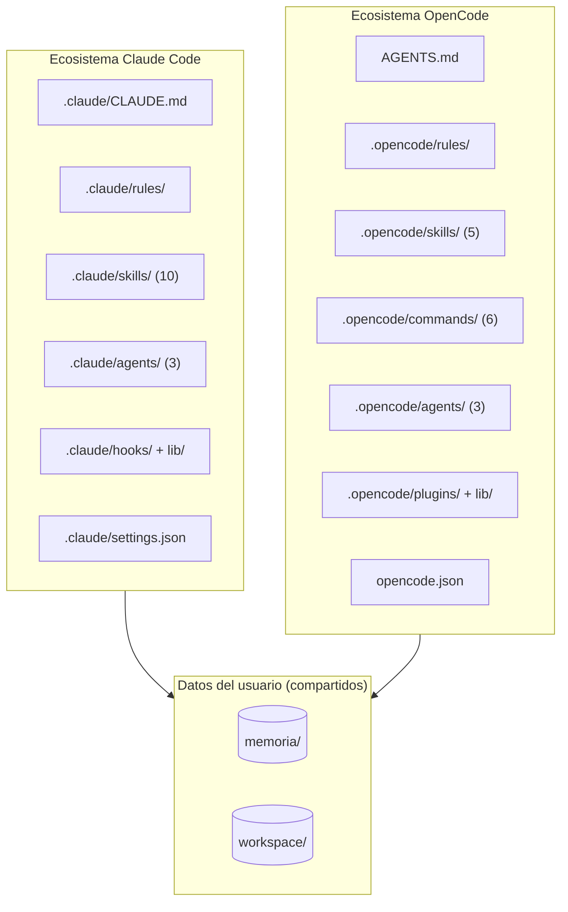

# Arquitectura

Cómo está organizado VITIDEV OS AI, qué contiene cada carpeta y qué se puede modificar.
El motivo de cada decisión está en [decisiones.md](decisiones.md).

## Principio: dos ecosistemas, unos datos

El repositorio contiene **dos implementaciones independientes** del mismo asistente:

- **Claude Code** usa solo `.claude/`.
- **OpenCode** usa solo `AGENTS.md`, `opencode.json` y `.opencode/`.

Ninguna importa, enlaza ni genera archivos de la otra. Las skills, reglas, agentes y lógica de
protección que existen en ambas son **copias separadas**: editar una no cambia la otra.

Lo único compartido son los **datos del usuario** (`memoria/` y `workspace/`), y es intencionado:
lo que guardas con una herramienta lo consultas con la otra.

## Cómo cada herramienta evita cargar lo de la otra

| Riesgo | Medida |
|---|---|
| Claude Code lee `AGENTS.md` si no hay `CLAUDE.md` | Existe `.claude/CLAUDE.md`, así que Claude Code no lee `AGENTS.md` |
| OpenCode usa `CLAUDE.md` de la raíz si no hay `AGENTS.md` | No hay `CLAUDE.md` en la raíz: está en `.claude/`, donde OpenCode no lo busca |
| OpenCode descubre skills en `.claude/skills/` y `~/.claude/skills/` | `.opencode/skills/` tiene prioridad para el mismo nombre y `permission.skill` deniega (`"*": "deny"`) toda skill que no sea de OpenCode |
| Dependencias de código entre ecosistemas | El plugin solo importa de `.opencode/lib/`; los hooks, de `.claude/hooks/lib/` |
| Que una regla o skill se cuele en el otro lado | `npm run validar` falla si un archivo de un ecosistema referencia al otro |

OpenCode V1 no carga `.claude/agents/` ni `.claude/commands/` (comprobado con `opencode debug`).
Para que ni siquiera descubra las skills de Claude Code, se puede iniciar con
`OPENCODE_DISABLE_CLAUDE_CODE_SKILLS=1` (ver [OPENCODE.md](OPENCODE.md)).

## Tipos de archivo

| Tipo | Significado | Ejemplo |
|---|---|---|
| **Operativo** | Tus datos; cambian con el uso | `memoria/objetivos.md` |
| **Plantilla** | Modelo que copian las skills | `.claude/skills/crear-proyecto/plantilla-proyecto.md` |
| **Configuración** | Define cómo se comporta una herramienta | `opencode.json` |
| **Código** | Scripts de Node.js | `.claude/hooks/lib/reglas.mjs` |
| **Generado por la herramienta** | Lo crea OpenCode; no se versiona | `.opencode/node_modules/` |
| **Documentación** | Para personas | `docs/` |

## Raíz del repositorio

| Archivo | Ecosistema | Para qué sirve | Precauciones |
|---|---|---|---|
| `AGENTS.md` | OpenCode | Instrucciones del agente en OpenCode | Claude Code no lo lee |
| `opencode.json` | OpenCode | Memoria y reglas (`instructions`), permisos y allowlist de skills | Sin `model`, `provider` ni claves: el validador falla |
| `package.json` | Común | Scripts `test`, `validar` y `probar:opencode` | Sin dependencias por diseño |
| `README.md`, `CHANGELOG.md`, `CONTRIBUTING.md`, `SECURITY.md`, `CODE_OF_CONDUCT.md`, `LICENSE` | Común | Documentación y licencia | |
| `BANNER.jpg` | Común | Imagen del README | |
| `.gitignore` | Común | Excluye secretos, configuración personal, archivos generados y tus datos | No quites las reglas de privacidad |

## `.claude/`: ecosistema Claude Code

| Elemento | Para qué sirve | Precauciones |
|---|---|---|
| `CLAUDE.md` | Instrucciones; importa los 4 archivos de memoria con `@../memoria/...` | Las rutas de import son relativas a `.claude/` |
| `rules/` | Seguridad, estilo, memoria y workspace | `memoria.md` y `workspace.md` se cargan al tocar esas carpetas (`paths:`) |
| `skills/` | 5 skills de capacidad y 5 skills-comando (`disable-model-invocation: true`) | `name` igual que la carpeta |
| `agents/` | `tutor`, `investigador`, `project-manager` (solo lectura) | Campo `tools`, `model: inherit` |
| `hooks/session-start.mjs` | `SessionStart`: resumen de estado | |
| `hooks/proteger.mjs` | `PreToolUse`: bloquea secretos y comandos destructivos | Lógica en `hooks/lib/reglas.mjs` |
| `hooks/lib/` | `reglas.mjs` y `estado.mjs` | Solo los usa Claude Code |
| `settings.json` | Permisos y registro de hooks | No relajes los `deny` |
| `settings.local.json` | Ajustes personales (opcional) | Excluido de git |

## `.opencode/`: ecosistema OpenCode

| Elemento | Para qué sirve | Precauciones |
|---|---|---|
| `rules/` | Seguridad, estilo, memoria y workspace | Todas deben figurar en `instructions` de `opencode.json` |
| `skills/` | 5 skills de capacidad | Cada una debe estar en `allow` de `permission.skill` |
| `commands/` | 6 comandos con `$ARGUMENTS` | Contenido propio; no cargan archivos de Claude Code |
| `agents/` | Los 3 subagentes (`mode: subagent`, `permission`) | Sin `model` ni `tools` |
| `plugins/vitidev.js` | Protección (`tool.execute.before`) y resumen de estado | Solo `export default`. Funciona en V1, no en V2 |
| `lib/` | `reglas.mjs`, `estado.mjs` y `adaptador.mjs` | Copia propia de la lógica de protección |
| `node_modules/`, `package.json`, `package-lock.json` | SDK de plugins que instala OpenCode | Generados, excluidos de git |

## Datos del usuario

`memoria/` se distribuye con plantillas vacías (mapa en [memoria/INDICE.md](../memoria/INDICE.md)).
`workspace/` solo versiona sus `README.md` y el ejemplo del inbox.

| Elemento | Contenido |
|---|---|
| `memoria/personal/` | `perfil.md`, `preferencias.md` |
| `memoria/objetivos.md` | Metas por plazo |
| `memoria/proyectos/` | `activos.md`, `pausados.md`, `finalizados.md` |
| `memoria/aprendizajes/`, `memoria/sesiones/` | Un archivo por tema o por día (excluidos de git) |
| `memoria/inbox.md` | Datos sin clasificar |
| `workspace/` | `proyectos/`, `universidad/`, `investigaciones/`, `entregables/`, `inbox/`, `_archivo/` |

## Calidad

| Elemento | Para qué sirve |
|---|---|
| `scripts/validar.mjs` | Estructura de ambos ecosistemas, frontmatter, rutas, permisos, ausencia de credenciales y de dependencias cruzadas |
| `scripts/probar-opencode.mjs` | Comprueba el OpenCode instalado con `opencode debug`, sin llamar a ningún modelo |
| `tests/` | 32 pruebas con `node:test` |
