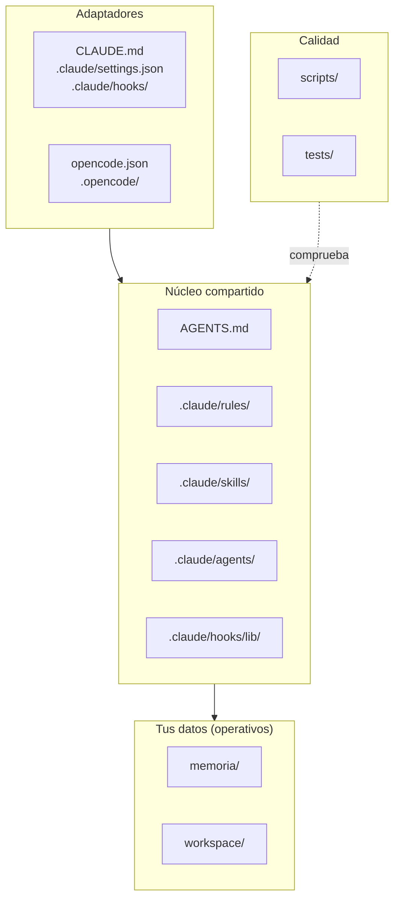

# Estructura del proyecto

Qué hay en cada carpeta, para qué sirve y si puedes modificarlo. Para el motivo de cada decisión,
consulta [decisiones.md](decisiones.md).

## Tipos de archivo

| Tipo | Significado | Ejemplo |
|---|---|---|
| **Operativo** | Tus datos. Están hechos para cambiar con el uso | `memoria/objetivos.md` |
| **Plantilla** | Modelo que copian los comandos o que completas tú | `.claude/skills/crear-proyecto/plantilla-proyecto.md` |
| **Configuración** | Define cómo se comporta la herramienta | `opencode.json` |
| **Código** | Scripts de Node.js | `.claude/hooks/lib/reglas.mjs` |
| **Generado** | Se crea a partir de otro archivo: no lo edites a mano | `.opencode/agents/` |
| **Documentación** | Explicaciones para personas | `docs/` |

## Vista general

## Raíz del repositorio

| Archivo | Tipo | Para qué sirve | ¿Modificable? | Precauciones |
|---|---|---|---|---|
| `AGENTS.md` | Configuración | Instrucciones centrales para ambas herramientas: identidad, mapa, forma de trabajar y reglas | Sí, con cuidado | Afecta a las dos herramientas. Las herramientas piden confirmación al editarlo |
| `CLAUDE.md` | Configuración | Claude Code: importa `AGENTS.md` y los cuatro archivos de memoria | Solo para lo exclusivo de Claude Code | La lista de memoria debe coincidir con `instructions` de `opencode.json` |
| `opencode.json` | Configuración | OpenCode: memoria y reglas (`instructions`), skills y permisos | Sí, con cuidado | No añadas `model`, `provider` ni claves: el validador falla |
| `package.json` | Configuración | Scripts `test`, `validar`, `sincronizar` y `probar:opencode` | Rara vez | Sin dependencias por diseño |
| `README.md` | Documentación | Presentación del proyecto | Sí | |
| `BANNER.jpg` | Recurso | Imagen de cabecera del README | No | Identidad visual del proyecto |
| `LICENSE` | Legal | Licencia MIT | No | |
| `CHANGELOG.md` | Documentación | Historial de versiones | Al publicar cambios | |
| `CONTRIBUTING.md`, `SECURITY.md`, `CODE_OF_CONDUCT.md` | Documentación | Contribución, seguridad y convivencia | Sí | |
| `.gitignore` | Configuración | Excluye secretos, archivos generados y tus datos personales | Sí | No quites las reglas de privacidad |

## `memoria/`: memoria persistente (operativo)

Compartida por las dos herramientas. Se distribuye con **plantillas vacías**. Mapa completo en
[memoria/INDICE.md](../memoria/INDICE.md).

| Elemento | Contenido | ¿Modificable? | Precauciones |
|---|---|---|---|
| `memoria/personal/` | `perfil.md` y `preferencias.md` | Sí, a mano o con `/conocerme` | Conserva el frontmatter con `tipo`. Datos personales: no los publiques |
| `memoria/objetivos.md` | Metas por plazo, con casillas `[ ]` y `[x]` | Sí | |
| `memoria/proyectos/` | `activos.md`, `pausados.md`, `finalizados.md` | Sí | Un proyecto vive en un solo archivo. Usa la plantilla de registro |
| `memoria/aprendizajes/` | Un archivo por tema e `INDICE.md` | Sí | Los archivos nuevos están excluidos de git |
| `memoria/sesiones/` | Un resumen por día creado por `/cerrar-sesion` | Sí | Excluidos de git. El último alimenta el resumen de inicio |
| `memoria/inbox.md` | Datos pendientes de clasificar | Sí | `/organizar` los reparte |
| `memoria/INDICE.md` | Mapa de la memoria | Solo si añades categorías | |

## `workspace/`: espacio de trabajo (operativo)

Reglas en `.claude/rules/workspace.md`. Solo se versionan los `README.md` y el ejemplo del inbox; el
resto de lo que crees aquí está excluido de git.

| Carpeta | Contenido | Precauciones |
|---|---|---|
| `workspace/proyectos/` | Una carpeta por proyecto con su `PROYECTO.md` | Créalas con `/crear-proyecto` para que queden registradas en memoria |
| `workspace/universidad/` | Una carpeta por materia | |
| `workspace/investigaciones/` | Informes de `/investigar` | Contienen URLs y citas de fuentes externas |
| `workspace/entregables/` | Versiones finales | |
| `workspace/inbox/` | Material sin ordenar. Incluye `ejemplo-notas-sueltas.md` para el taller | El ejemplo es ficticio: puedes borrarlo en tu copia |
| `workspace/_archivo/` | Lo que se descarta, en lugar de borrarlo | Solo tú lo vacías |

## `.claude/`: núcleo compartido y adaptador de Claude Code

| Elemento | Tipo | Para qué sirve | ¿Modificable? | Precauciones |
|---|---|---|---|---|
| `.claude/rules/` | Configuración | Reglas de seguridad, memoria, workspace y estilo | Sí | Si añades una regla, regístrala también en `instructions` de `opencode.json` |
| `.claude/skills/` | Configuración y plantillas | 10 skills compartidas y sus plantillas | Sí | `name` igual que la carpeta. Una sola copia: OpenCode la lee de aquí |
| `.claude/agents/` | Configuración | Fuente de los 3 agentes | Sí | Después ejecuta `npm run sincronizar` |
| `.claude/hooks/session-start.mjs` | Código | Hook `SessionStart`: resumen de estado | Rara vez | |
| `.claude/hooks/proteger.mjs` | Código | Hook `PreToolUse`: bloquea secretos y comandos destructivos | Rara vez | La lógica está en `lib/` |
| `.claude/hooks/lib/` | Código | `reglas.mjs` (protección), `estado.mjs` (resumen), `opencode.mjs` (adaptador) | Con pruebas | La usan Claude Code y OpenCode: cualquier cambio afecta a ambas |
| `.claude/settings.json` | Configuración | Permisos allow, ask y deny, y registro de hooks | Con cuidado | No relajes los `deny` |
| `.claude/settings.local.json` | Configuración personal | Ajustes tuyos de Claude Code (opcional, no existe por defecto) | Sí | Excluido de git |

### Las 10 skills

| Carpeta | Tipo | Archivos adicionales |
|---|---|---|
| `aprender` | Capacidad | `plantilla-aprendizaje.md` |
| `investigar` | Capacidad | `plantilla-informe.md` |
| `organizar` | Capacidad | |
| `crear-proyecto` | Capacidad | `plantilla-proyecto.md`, `plantilla-registro.md` |
| `gestionar-memoria` | Capacidad | |
| `conocerme`, `estudiar`, `guardar`, `revisar-proyectos`, `cerrar-sesion` | Comando (solo las lanza el usuario) | |

## `.opencode/`: adaptador de OpenCode

| Elemento | Tipo | Para qué sirve | ¿Modificable? |
|---|---|---|---|
| `.opencode/agents/` | Generado | Los 3 agentes en formato OpenCode (`mode: subagent`, `permission`) | No: edita `.claude/agents/` y ejecuta `npm run sincronizar` |
| `.opencode/commands/` | Configuración | 6 comandos que cargan la skill correspondiente y pasan `$ARGUMENTS` | Sí, sin poner lógica: la lógica va en la skill |
| `.opencode/plugins/vitidev.js` | Código | Protección y resumen de estado en OpenCode V1 | Rara vez; no funciona en V2 |
| `.opencode/node_modules/`, `package.json` y otros | Generado por OpenCode | SDK de plugins | No. Excluidos de git |

## `scripts/`, `tests/` y `docs/`

| Elemento | Para qué sirve |
|---|---|
| `scripts/validar.mjs` | `npm run validar`: estructura, frontmatter, enlaces, rutas, comandos, coherencia entre herramientas y ausencia de credenciales |
| `scripts/sincronizar-agentes.mjs` | `npm run sincronizar`: genera `.opencode/agents/` desde `.claude/agents/` |
| `scripts/probar-opencode.mjs` | `npm run probar:opencode`: comprueba OpenCode con `opencode debug`, sin llamar a ningún modelo |
| `tests/` | 30 pruebas con `node:test`: estructura, protección, memoria y OpenCode |
| `docs/` | Esta documentación: primeros pasos, FAQ, glosario, privacidad, decisiones, limitaciones y guía de taller |
| `.github/` | Plantillas de issues y de Pull Request |

## Qué puedes tocar sin miedo

| Siempre | Con cuidado | Nunca a mano |
|---|---|---|
| `memoria/`, `workspace/`, tus skills nuevas, documentación | `AGENTS.md`, `opencode.json`, `.claude/settings.json`, `.claude/rules/`, código de `lib/` | `.opencode/agents/`, `.opencode/node_modules/` |

Después de cualquier cambio en la configuración o en las skills, ejecuta `npm test` y abre una
sesión nueva.
