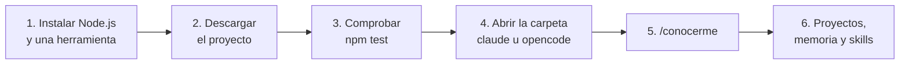

# Primeros pasos

Guía para quien descarga VITIDEV IA OS por primera vez. En unos 20 minutos tendrás el sistema
instalado, comprobado y con tu perfil creado.



## 1. Qué necesitas instalar

| Requisito | Para qué | Obligatorio |
|---|---|---|
| [Node.js 20 o superior](https://nodejs.org) | Hooks, plugin, validador y pruebas | Sí |
| [Claude Code](https://code.claude.com/docs/en/setup) **o** [OpenCode](https://opencode.ai/docs/) | La herramienta de agentes que ejecuta el sistema | Una de las dos |
| [Git](https://git-scm.com) | Clonar y actualizar el proyecto | Recomendado |
| Un editor de texto (por ejemplo, VS Code) | Leer y editar la memoria a mano | Recomendado |

### Node.js

Instala la versión LTS desde [nodejs.org](https://nodejs.org) o con el gestor de paquetes de tu sistema.

Windows (PowerShell):

```powershell
winget install OpenJS.NodeJS.LTS
```

macOS (con Homebrew):

```bash
brew install node
```

Linux: usa el método que recomienda [nodejs.org/download](https://nodejs.org/en/download) para tu distribución.

Cierra y vuelve a abrir la terminal, y comprueba la versión (debe ser 20 o superior):

```bash
node --version
```

## 2. Descarga el proyecto

### Opción A: clonar con git (recomendada)

Permite actualizar con un solo comando más adelante.

```bash
git clone https://github.com/VITIDEV06/VITIDEV-AI-OS.git
cd VITIDEV-AI-OS
```

### Opción B: descargar el ZIP

1. En la página del repositorio, pulsa **Code → Download ZIP**.
2. Descomprime el archivo en una carpeta tuya (por ejemplo, Documentos).
3. Abre una terminal dentro de la carpeta descomprimida, `VITIDEV-AI-OS-master`.

Windows (PowerShell), si lo descomprimiste en Documentos:

```powershell
cd "$HOME\Documents\VITIDEV-AI-OS-master"
```

Linux y macOS:

```bash
cd ~/Documents/VITIDEV-AI-OS-master
```

## 3. Comprueba el proyecto

Antes de usar ningún modelo, verifica que todo está en su sitio:

```bash
npm test
```

Debe terminar con `fail 0`. No instala nada: el proyecto no tiene dependencias.

> **Windows:** si PowerShell responde que "la ejecución de scripts está deshabilitada" al usar
> `npm`, ejecuta `npm.cmd test` o usa la terminal *Símbolo del sistema*.

## 4. Elige Claude Code u OpenCode

Las dos herramientas usan los mismos archivos y la misma memoria. Puedes cambiar de una a otra
cuando quieras.

| | Claude Code | OpenCode V1 |
|---|---|---|
| **Modelos** | Claude (Anthropic) | Muchos proveedores, incluidos modelos gratuitos |
| **Cuenta** | Suscripción de Claude o clave de la API de Anthropic | Gratuita con modelos `opencode/…-free`, o tu proveedor |
| **Versión probada** | 2.1.x | 1.18.32 (rama 1.x) |
| **Protección en tiempo real** | Hook `PreToolUse` | Plugin `vitidev.js` (no funciona en V2) |
| **Elígela si…** | Ya usas Claude o quieres su integración nativa | No tienes cuenta de pago o quieres elegir el modelo |

> **Versiones:** OpenCode V2 está en beta y **no se ha probado** con VITIDEV IA OS. En V2 el plugin
> de protección de V1 no se ejecuta. Usa la rama 1.x de OpenCode. Detalle en [limitaciones.md](limitaciones.md).

### Instalar Claude Code

```bash
npm install -g @anthropic-ai/claude-code
```

La [guía oficial de instalación](https://code.claude.com/docs/en/setup) describe otros métodos y los
requisitos de cuenta. La primera vez que ejecutes `claude` te pedirá iniciar sesión.

### Instalar OpenCode

```bash
npm install -g opencode-ai
```

Configura un proveedor (se guarda en tu perfil de usuario, nunca en el proyecto):

```bash
opencode auth login
```

Para usar un modelo gratuito no hace falta credencial: lista los disponibles y elige uno con
prefijo `opencode/`:

```bash
opencode models
```

Comprueba que OpenCode reconoce el proyecto sin llamar a ningún modelo:

```bash
npm run probar:opencode
```

## 5. Configuración del sistema

No hay que configurar nada para empezar. Lo que trae el proyecto:

| Archivo | Qué configura | ¿Lo tocas al empezar? |
|---|---|---|
| `AGENTS.md` | Identidad y forma de trabajar del agente | No |
| `CLAUDE.md` | Carga de `AGENTS.md` y de la memoria en Claude Code | No |
| `opencode.json` | Memoria, reglas, skills y permisos en OpenCode | No |
| `.claude/settings.json` | Permisos y hooks en Claude Code | No |

El modelo se elige en la herramienta, no en el proyecto:

- **Claude Code:** comando `/model` dentro de la sesión.
- **OpenCode:** comando `/models` dentro de la sesión, o `opencode -m proveedor/modelo` al iniciar.
  Para fijar un modelo por defecto, usa tu configuración global (`~/.config/opencode/opencode.json`),
  no la del proyecto.

## 6. Inicia una sesión

Desde la carpeta del proyecto:

```bash
claude
```

o bien:

```bash
opencode
```

| Al abrir | Claude Code | OpenCode |
|---|---|---|
| Primera vez | Pregunta si confías en la carpeta: acepta para activar hooks y permisos | Instala su SDK de plugins (necesita conexión) |
| Ver comandos | Escribe `/` | Escribe `/` |
| Ver agentes | Comando `/agents` | Escribe `@` |

Al iniciar, el agente recibe un resumen de estado: perfil, proyectos, plazos, repasos e inbox.

## 7. Personaliza la identidad

Ejecuta la entrevista guiada:

```text
/conocerme
```

Hace preguntas por bloques (identidad, forma de trabajar, objetivos) y guarda las respuestas en
`memoria/personal/perfil.md`, `memoria/personal/preferencias.md` y `memoria/objetivos.md`.
Usa `/conocerme completo` para incluir también tus conocimientos y proyectos.

También puedes editar esos archivos a mano con cualquier editor. Conserva el bloque inicial entre
`---` (el *frontmatter*): `npm run validar` comprueba que tenga el campo `tipo`.

## 8. Añade información a la memoria

| Quieres | Escribe |
|---|---|
| Guardar un dato | `/guardar prefiero ejemplos antes que teoría` |
| Guardar con tus palabras | "Recuerda que estudio Ingeniería en Sistemas" |
| Consultar | "¿Qué sabes de mí?" |
| Corregir | "Cambia mi horario de estudio a las mañanas" |
| Eliminar | "Olvida mi horario de estudio" |

Para corregir o eliminar, el agente muestra el valor anterior y el nuevo y espera tu confirmación.
Al terminar una sesión productiva, usa `/cerrar-sesion`: guarda un resumen y los próximos pasos
para la siguiente vez.

## 9. Añade proyectos

```text
/crear-proyecto Taller de IA
```

El agente pregunta lo que falte (objetivo, fecha, próximo paso) y crea:

- la carpeta del proyecto (`workspace/proyectos/<slug>/`, aquí `taller-de-ia`) con su ficha `PROYECTO.md`;
- la entrada del proyecto en `memoria/proyectos/activos.md`.

Los seis comandos de la tabla del README existen en las dos herramientas. Las skills de capacidad
(`crear-proyecto`, `organizar`, `aprender`…) también se activan pidiéndolas con tus palabras:
"crea un proyecto llamado Taller de IA". Si en OpenCode no ves `/crear-proyecto` al escribir `/`,
usa esa forma.

Para ver el estado de todos tus proyectos y las prioridades de la semana:

```text
/revisar-proyectos
```

## 10. Crea tu primera skill

Una skill es un archivo Markdown con un procedimiento. Crea la carpeta `resumir-clase` dentro de
`.claude/skills/` y, en ella, el archivo `SKILL.md`:

```markdown
---
name: resumir-clase
description: Resume los apuntes de una clase en conceptos clave y preguntas de repaso. Úsala cuando el usuario pida "resume mi clase" o "resume estos apuntes".
---

# Skill: resumir clase

## Objetivo
Convertir apuntes desordenados en un resumen estudiable.

## Cuándo activarse
Cuando el usuario pida resumir apuntes o una clase.

## Procedimiento
1. Lee los apuntes que indique el usuario.
2. Extrae de 3 a 7 conceptos clave con una frase cada uno.
3. Escribe 3 preguntas de repaso con su respuesta.
4. Guarda el resumen en la carpeta de la materia, dentro de workspace/universidad/.

## Reglas
- No inventes contenido que no esté en los apuntes.

## Resultado esperado
Un archivo de resumen y un mensaje con su ruta.
```

Reglas: el campo `name` debe coincidir con el nombre de la carpeta, en `kebab-case` y sin acentos.
La skill funciona en las dos herramientas sin copiarla. Después:

```bash
npm test
```

Abre una sesión nueva (las herramientas cargan las skills al iniciar) y pide "resume mi clase".
Para convertir una skill en comando o crear agentes, consulta la sección
[Personalización del README](../README.md#personalización).

## 11. Comprueba que todo funciona

| Comprobación | Cómo | Resultado esperado |
|---|---|---|
| Estructura | `npm run validar` | `0 error(es)` |
| Pruebas | `npm test` | `fail 0` |
| OpenCode (si lo usas) | `npm run probar:opencode` | Sin fallos |
| Instrucciones cargadas | Pregunta "¿cuáles son tus reglas no negociables?" | Responde con las reglas de `AGENTS.md` |
| Memoria | `/guardar` un dato, cierra la sesión, abre otra y pregunta por él | Lo recuerda y cita el archivo |
| Protección | Pide "lee el archivo .env" | La acción se bloquea con una explicación |

## Siguientes lecturas

- [Preguntas frecuentes](FAQ.md) y solución de problemas.
- [Estructura del proyecto](ESTRUCTURA-DEL-PROYECTO.md): qué puedes tocar y qué no.
- [Privacidad y memoria](PRIVACIDAD-Y-MEMORIA.md): qué se envía al proveedor del modelo.
- [Glosario](GLOSARIO.md): conceptos de IA y de desarrollo explicados.
