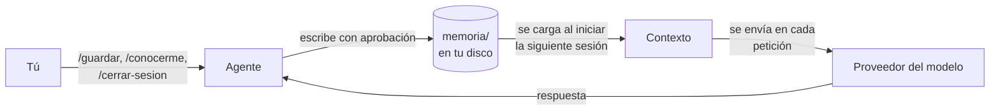

# Privacidad y memoria

Qué guarda VITIDEV IA OS, qué se envía al proveedor del modelo y cómo mantener tu información
bajo control. Resumen: **la memoria vive en tu disco, pero el modelo la recibe como contexto.**
El proyecto no puede garantizar privacidad absoluta ni funcionamiento sin conexión.

## Qué se almacena localmente

| Ubicación | Contenido | Quién lo escribe |
|---|---|---|
| `memoria/personal/` | Perfil y preferencias | `/conocerme`, `/guardar` o tú |
| `memoria/objetivos.md` | Metas a corto, medio y largo plazo | `/conocerme`, `/guardar` |
| `memoria/proyectos/` | Registro de proyectos activos, pausados y finalizados | `crear-proyecto`, `/revisar-proyectos` |
| `memoria/aprendizajes/` | Un archivo por tema estudiado, con fecha de repaso | `/estudiar`, skill `aprender` |
| `memoria/sesiones/` | Resumen de cada sesión cerrada | `/cerrar-sesion` |
| `memoria/inbox.md` | Datos pendientes de clasificar | `/guardar` |
| `workspace/` | Tus archivos de trabajo: fichas, apuntes, informes, entregables | Tú y el agente |

Todo es texto plano (Markdown), sin cifrar, con los permisos de tu usuario del sistema operativo.

Fuera del proyecto, cada herramienta guarda además sus propios datos: credenciales del proveedor,
configuración global e historial de sesiones. Eso lo gestionan Claude Code u OpenCode, no VITIDEV IA OS.

## Cómo funciona la memoria

1. **Escritura.** Los datos nuevos se añaden directamente. Para cambiar o eliminar un dato existente,
   el agente muestra el valor anterior y el nuevo y espera tu confirmación.
2. **Carga selectiva.** Al iniciar una sesión se cargan solo cuatro archivos: perfil, preferencias,
   objetivos y proyectos activos. Lo demás se lee bajo demanda.
3. **Resumen de estado.** El hook `SessionStart` (Claude Code) o el plugin (OpenCode) añade un
   resumen calculado: número de proyectos, plazos próximos, repasos pendientes, elementos del inbox
   y próximos pasos de la última sesión.

## Cómo se construye el contexto

| Capa | Origen | Cuándo |
|---|---|---|
| Instrucciones | `AGENTS.md` y `.claude/rules/` | Al iniciar |
| Memoria básica | Los cuatro archivos anteriores | Al iniciar |
| Resumen de estado | Calculado a partir de `memoria/` y `workspace/inbox/` | Al iniciar (en OpenCode, en cada turno) |
| Skills | `.claude/skills/` | La descripción, siempre; el procedimiento, al usarla |
| Archivos | Cualquier archivo que el agente lea | Durante la sesión |
| Conversación | Tus mensajes y las respuestas | Durante la sesión |

## Qué puede recibir el proveedor del modelo

**Todo lo que forma parte del contexto se envía al proveedor** (Anthropic en Claude Code, o el que
elijas en OpenCode) para generar cada respuesta. Eso incluye:

- la memoria básica cargada al iniciar y el resumen de estado;
- los archivos de `memoria/` o `workspace/` que el agente lea;
- tus mensajes y los resultados de las herramientas (por ejemplo, la salida de un comando);
- el contenido de páginas web consultadas por el agente `investigador`.

Lo que ocurre después con esos datos (retención, uso para entrenamiento, ubicación de los servidores)
depende de **las condiciones de tu proveedor y de tu tipo de cuenta**, no de este proyecto. Revísalas,
en especial con modelos gratuitos.

## Memoria local frente a privacidad del proveedor

| | Memoria local de VITIDEV IA OS | Proveedor del modelo |
|---|---|---|
| **Dónde está** | En tu disco | En los servidores del proveedor |
| **Quién la controla** | Tú: puedes leerla, editarla y borrarla | El proveedor, según sus condiciones |
| **Persistencia** | Hasta que la borres | Según la política de retención del proveedor |
| **Qué contiene** | Solo lo guardado en `memoria/` y `workspace/` | Lo que se envió en cada sesión |
| **Borrar aquí** | Elimina el dato de futuras sesiones | No borra lo que ya se envió |

## Cómo evitar almacenar secretos

- No guardes contraseñas, tokens, números de tarjeta, documentos de identidad ni datos médicos o
  financieros detallados. Las reglas del agente le indican rechazarlo y sugerir un gestor de contraseñas.
- No pegues claves en el chat: pasan a formar parte del contexto enviado.
- Si necesitas archivos sensibles en el proyecto, ponlos en `.env`, `secrets/` o `credenciales/`:
  el hook y el plugin impiden que el agente los lea, y `.gitignore` los excluye de git.

## Cómo proteger tus archivos personales

| Riesgo | Protección |
|---|---|
| Publicar tu memoria en GitHub | `.gitignore` excluye el contenido creado en `memoria/aprendizajes/`, `memoria/sesiones/` y `workspace/`. Para las plantillas versionadas, usa `--skip-worktree` ([SECURITY.md](../SECURITY.md#memoria-y-workspace-antes-de-publicar)) |
| Que otra persona use tu equipo | Protege tu cuenta del sistema operativo; los archivos no están cifrados |
| Copias de seguridad en la nube | Si la carpeta está en una carpeta sincronizada (OneDrive, iCloud, Dropbox), la memoria también se sube allí |
| Compartir la carpeta en un taller | Entrega siempre una copia limpia del repositorio, nunca la tuya |

## Cómo limpiar información

| Quieres eliminar | Cómo |
|---|---|
| Un dato concreto | Pide "olvida…": el agente muestra qué líneas quitará y espera tu confirmación |
| Un aprendizaje o una sesión | Borra su archivo de `memoria/aprendizajes/` o `memoria/sesiones/` y su línea en `aprendizajes/INDICE.md` |
| Un proyecto | Pide moverlo a finalizados, o borra su sección del registro y su carpeta de `workspace/proyectos/` |
| Lo archivado | Vacía `workspace/_archivo/` tú mismo: el agente nunca lo hace |
| Todo | Si usas git: `git checkout -- memoria/` restaura las plantillas versionadas; después borra a mano los archivos nuevos de `memoria/` y `workspace/` |

El agente no borra archivos de memoria completos ni ejecuta borrados recursivos: está bloqueado a
propósito. Las limpiezas grandes las haces tú desde el explorador de archivos o la terminal.

Recuerda que borrar en local no elimina lo que ya se envió al proveedor ni el historial que guarde la
propia herramienta. Para eso, consulta la configuración de privacidad de tu cuenta en el proveedor.
